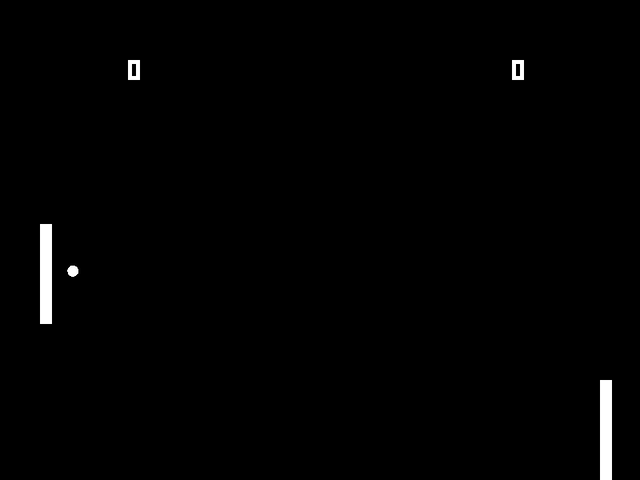

# Piung

[](https://github.com/jtravesi/Piung/actions/workflows/ci.yml)
[](LICENSE)

A Pong clone written in C++ with [SFML](https://www.sfml-dev.org/). You play the left paddle against the computer.



## Download

Ready-to-run builds for Linux, Windows and macOS are attached to every [release](https://github.com/jtravesi/Piung/releases/latest). Unpack the archive and run `piung` (`piung.exe` on Windows), keeping the `Resources` folder next to it.

- **Linux:** x86_64, built on a recent Ubuntu. It only needs X11 and OpenGL, which any desktop has, and runs on Wayland through XWayland. Distributions much older than the build machine may lack the glibc it needs; build from source there.
- **Windows:** 64-bit. No installer and nothing else to install.
- **macOS:** Apple Silicon. The app is not signed, so macOS refuses to open it the first time: right-click `piung`, choose **Open** and confirm.

## Controls

| Key | Action |
|---|---|
| <kbd>Enter</kbd> | Start the match |
| <kbd>↑</kbd> / <kbd>↓</kbd> | Move your paddle |
| <kbd>Esc</kbd> | Quit |

The game pauses while its window is in the background.

## How it plays

- The ball speeds up a little with every hit, and resets when someone scores.
- Where the ball hits the paddle sets its angle: the centre sends it straight back, the edges send it off at up to about 45 degrees.
- Serves alternate between both sides after each point.
- The opponent re-aims four times per second at the point where the ball's current path crosses its paddle, with a random error of up to 50 pixels. It ignores wall bounces, which is where it is easiest to beat.
- There is no score limit. Play for as long as you like.

## Building from source

You need **CMake 3.28+** and a **C++17 compiler** (GCC, Clang or MSVC). CMake downloads and builds SFML 3 for you, so there is nothing else to install on Windows or macOS. On Linux, install the X11, OpenGL and udev development files first:

```bash
# Debian / Ubuntu
sudo apt install libx11-dev libxrandr-dev libxcursor-dev libxi-dev libudev-dev libgl1-mesa-dev

# Arch / CachyOS
sudo pacman -S --needed libx11 libxrandr libxcursor libxi systemd-libs mesa
```

Then build and run:

```bash
cmake -S . -B build -DCMAKE_BUILD_TYPE=Release
cmake --build build --config Release
./build/piung
```

On Windows the same commands leave the game in `build\Release\piung.exe`. Visual Studio can also open the folder directly, since it understands `CMakeLists.txt`.

If you already have SFML 3 installed, configure with `-DPIUNG_USE_SYSTEM_SFML=ON` to use it instead of downloading it.

## Project structure

| Path | What it contains |
|---|---|
| `src/Game` | Window, main loop and the stack of game states |
| `src/GameState` | The match: score, sounds and the start screen |
| `src/Ball` | Ball movement and wall bounces |
| `src/Paddle` | Shared paddle logic and ball collisions |
| `src/PlayerPaddle` | Keyboard-controlled paddle |
| `src/EnemyPaddle` | Computer-controlled paddle |
| `src/Resources` | Finds the `Resources` folder next to the executable |
| `Resources/` | Font and sound effects |
| `tools/generate_sounds.py` | Generates the sound effects |

## Credits

- Font: [Bit5x3](https://www.mattlag.com/bitfonts/) by Matt LaGrandeur. See [its license notice](Resources/Fonts/bit5x3-LICENSE.txt).
- Sound effects: square-wave tones in the style of the original Pong, generated by [`tools/generate_sounds.py`](tools/generate_sounds.py).

## License

The code is released under the [MIT License](LICENSE). The font keeps its own license.
